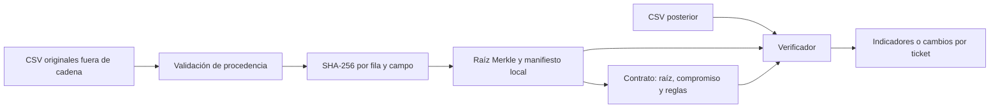

# ATENEA · Reto 03 · Nivel 1

Indicador recomputable sobre los 187 tickets del paquete entregado. Valida los originales, ancla un compromiso en una EVM local y detecta cambios por ticket y campo. Alcance exclusivo: Nivel 1.

Repositorio público: pendiente de publicar.

## Ejecutar

Requisitos: Node.js 22 o superior, npm y un navegador moderno. La auditoría y el asistente de edición manual requieren Microsoft Edge.

En el equipo preparado puedes abrir **INICIAR_APP.cmd** o **INICIAR_DEMO.cmd** con doble clic. El lanzador usa el node.exe del PATH; si no existe, indica instalar Node 22 o superior. En otro equipo, instalar Node y las dependencias como se indica abajo.

```powershell
npm.cmd ci --no-audit --no-fund
npm.cmd start
```

Abrir http://127.0.0.1:8080. No abrir index.html con file://. Blockchain: http://127.0.0.1:8545, chain ID 31337. Ambos servicios escuchan exclusivamente en loopback. Ctrl+C detiene el proceso.

La primera ejecución despliega el contrato, pero no sella los CSV. Cargar originales y pulsar **Sellar julio en blockchain**. Para consultar un sello existente, iniciar y pulsar **Verificar nuevamente contra blockchain**.

El estado persiste en `.instances/nivel1-corregido/`. Las rutas `/evidencias/` de la aplicación corresponden a la instancia activa. La carpeta `evidencias/` del repositorio contiene copias de los resultados de auditoría, no la base de datos blockchain. Una clonación limpia crea su propia instancia.

## Demostración desde cero

Detener cualquier servidor anterior y ejecutar:

```powershell
npm.cmd run demo
```

Cada ejecución crea `.instances/demo-<fecha>/`, con contrato sin sellar. No borra ni reemplaza instancias. Seguir [docs/DEMO.md](docs/DEMO.md): cinco criterios en orden, cinco minutos. Para retomar una instancia, establecer `$env:ATENEA_INSTANCE='demo-...'` y ejecutar `npm.cmd start`. Para volver a la normal: `Remove-Item Env:ATENEA_INSTANCE -ErrorAction SilentlyContinue`.

## Resultados sobre los originales

| Medida | Resultado |
|---|---:|
| IDs únicos del lote | 187 |
| A: cierres gestionados / recibidos | 187/187 = 100 % |
| B: confirmados por usuario / recibidos | 104/187 = 55,61 % |
| Cierres automáticos | 83 |
| Diferencia A − B | 44,39 puntos porcentuales |
| Publicado | 168/171; declara 98,25 % |
| A frente al publicado | +1,75 puntos porcentuales |
| Fuera de SLA con el calendario declarado | 66 |

Hay 185 reportes de julio y 2 de agosto: TK-2026-04386 y TK-2026-04387. Se conserva el lote completo porque el criterio exige 187 tickets. Se calcula su estado final, con cierres posteriores; no representa un corte al 31 de julio.

A exige estado CERRADO, fechas válidas y cierre CONFIRMADO POR USUARIO o AUTOMATICO 7 DIAS. B añade confirmación SI y tipo CONFIRMADO POR USUARIO. Un incumplimiento de SLA no excluye un cierre gestionado. No se fusionan reaperturas ni se valida aquí cada control institucional anterior al cierre.

## Procedencia y corrección

Los once archivos de `datos/` coinciden byte a byte con la carpeta fuente compartida para la revisión. `src/source-manifest.json` contiene sus SHA-256; `src/originals.json` contiene los hashes principales y el orden de IDs.

```powershell
npm.cmd run verify:source
npm.cmd run verify:source -- "RUTA_A_LA_CARPETA_FUENTE/datos"
```

El segundo comando compara una copia externa con las huellas del proyecto. También se comprueban los once archivos al iniciar. Una huella local es referencia de procedencia, no un certificado del organizador.

Se corrigió fecha_reporte de TK-2026-04201: la copia anterior tenía 13:39:55 y la fuente 12:39:55, el 31 de julio de 2026 (UTC−05:00). Se restauraron sus 8,4 horas hábiles. Los hashes antiguo y nuevo quedan documentados. Ver [docs/PROCEDENCIA.md](docs/PROCEDENCIA.md).

## Horas hábiles y feriados

El motor calcula la intersección con lunes a viernes, 08:00–17:00 en UTC−05:00, independientemente de la zona del equipo. Rechaza fechas inexistentes e intervalos invertidos. Descuenta las fechas ISO de `src/calendar.mjs`; hay pruebas de feriados, fines de semana y entradas inválidas.

**Supuesto del caso:** no se entregó calendario oficial de la entidad ficticia. La lista está vacía; no se presenta como calendario oficial. Si el organizador facilita fechas, incorporarlas con su fuente, incrementar la versión y usar una nueva instancia. El hash de reglas incluye el calendario. Ver [docs/CALENDARIO.md](docs/CALENDARIO.md).

El SLA procede del catálogo: crítica 4 h, alta 8 h, media 24 h, baja 72 h. Se recalculan horas desde fechas y se contrastan horas, SLA y cumplimiento declarados; no se usa cumple_sla como decisión de entrada. Con los originales actuales hay discrepancias en TK-2026-04385 y TK-2026-04386.

## Arquitectura y privacidad



La hoja Merkle serializa todas las columnas y su orden, índice y etiqueta atenea-ticket-v1. Prefijo 0x00 para hojas, 0x01 para padres; SHA-256 y duplicación de la última hoja en niveles impares. Pruebas con lado explícito. Los hashes de bytes completos protegen también el formato. El manifiesto compromete CSV, catálogo, reporte y política; su SHA-256 se ancla junto con la raíz.

El verificador consulta chain ID, bytecode, reglas, almacenamiento, evento, transacción y recibo. Sin RPC, con evidencia alterada o sin sello confirmado no muestra indicadores acreditados. El contrato impide reemplazar el sello del período.

Dentro: período, raíz, compromiso de evidencia, cantidad, timestamp, hash de reglas y direcciones EVM. Fuera: nombres, técnicos, unidades, contenido de tickets, CSV, manifiesto con IDs y cálculo. Sellar tiene cuatro argumentos de tamaño fijo: 132 bytes. No se publican contenidos de tickets en cadena, ni cifrados.

La EVM local demuestra el mecanismo; su operador controla el entorno. Para independencia pública se necesita un ancla externa y acceso autorizado a la evidencia. La operación interna puede usar bases de datos y logs firmados. No se obliga al usuario municipal a usar wallet. El sello prueba integridad posterior, no veracidad inicial ni mejora de atención.

## Contrato

`contracts/RegistroIndicador.sol`: Solidity 0.8.30, optimizador 200, EVM Shanghai. Instancia auditada: **0xe78A0F7E598Cc8b0Bb87894B0F60dD2a88d6a8Ab**, chain ID **31337**, Ganache local. Dirección y recibos: `evidencias/red-local.json` y `evidencias/blockchain.json`. Una dirección determinista puede repetirse en distintas instancias: contrastar también instancia, raíz y transacción. No es una dirección de testnet pública.

No usar las cuentas de desarrollo para fondos reales. Estados activos en `.instances/`, excluidos de Git.

## Pruebas y auditoría

Detener los servicios antes de auditar, ya que comparten puertos:

```powershell
npm.cmd test
npm.cmd run audit
```

Las pruebas del contrato usan EVM en memoria; la auditoría usa Edge y cadena persistida real. Comprueba sellado, recálculo, alteración, comparación, privacidad, caída RPC, recarga, reinicio y móvil. Exporta capturas y resultados a `evidencias/` y actualiza `AUDITORIA_NIVEL_1.md`. La prueba manual se acredita solo con confirmación humana y un CSV compatible con el mismo sello.

`.github/workflows/tests.yml` queda listo; se ejecutará cuando se publique el repositorio. Las 29 pruebas y la auditoría se ejecutaron localmente. 

Para un ensayo asistido: sellar primero la instancia normal, detenerla y ejecutar `npm.cmd run manual`. Abre el navegador y espera que la persona edite la copia cuya ruta imprime. La carga y verificación son automáticas; no se atribuye a una persona una edición realizada por el script.

## Entregables

- Código, contrato, pruebas y datos sintéticos.
- `docs/DEMO.md`: guion y preguntas del jurado.
- `presentacion/Nivel-1-arquitectura-y-delimitacion.pptx`: dos láminas editables.
- `docs/AUDITORIA.md` y `evidencias/`: resultados y edición manual confirmada.
- `docs/CALENDARIO.md`: supuesto y procedimiento para fechas oficiales.

No se implementan penalidades, firmas de proveedores ni controles opcionales de niveles 2 y 3 del reto. Se incluyen los tickets de todos los niveles de soporte: son conceptos distintos a los niveles de entrega del hackathon.
